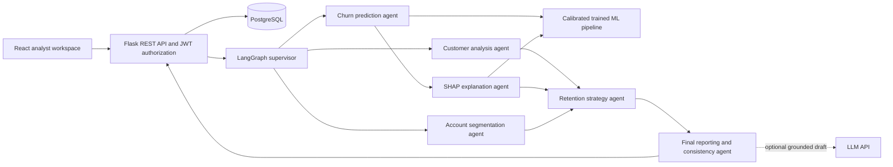
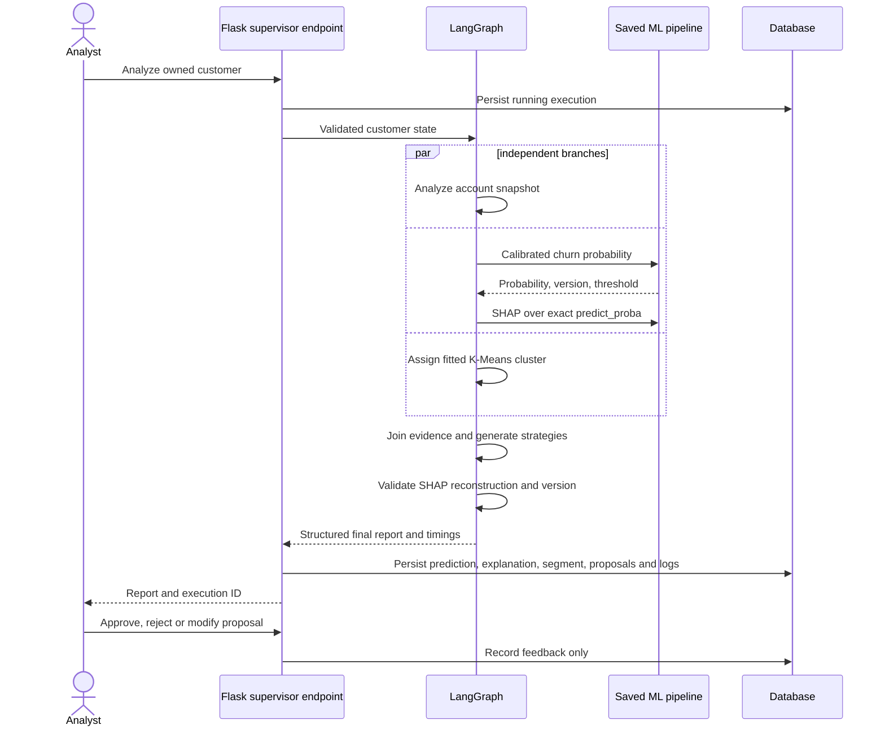

# Architecture

React calls authenticated Flask endpoints. JWT identity scopes every customer, execution, prediction and recommendation query to the owning analyst. SQLAlchemy persists the workflow outputs in PostgreSQL; SQLite is an explicit local development option. The ML artifact contains the exact preprocessing pipeline, calibrated estimator, training SHAP background and fitted account segmenter. No LLM estimates churn probabilities.

State is a TypedDict with separate outputs for each specialist and an append reducer for concurrent log writes. Node outputs merge into state, and a multi-source edge waits for independent branches before retention. Conditional routing permits reporting only when strategies exist; the supervisor rejects incomplete results. Transient timeout/connection failures receive at most two attempts. ML failures do not generate fake fallback probabilities. Failed execution status is stored and the client receives a generic error with an execution ID.

The chosen design uses deterministic evidence tools for the first five agents and an optional LLM draft in reporting. They are specialized workflow agents, not six autonomous LLM conversations. LangGraph is the actual orchestrator. Grounded structured fields remain authoritative when an LLM draft is present.
