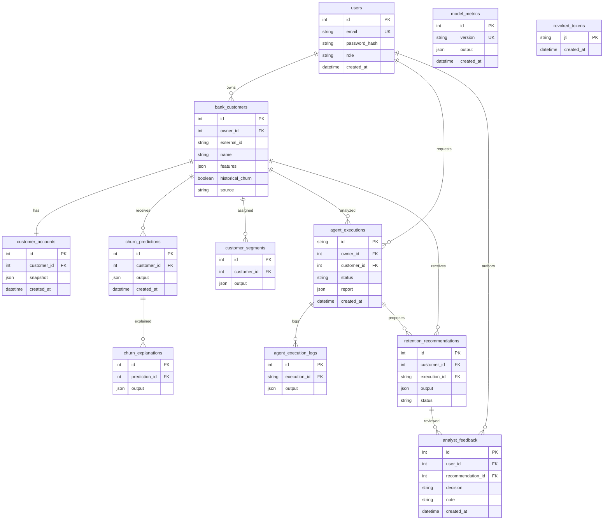

# Database design

The canonical schema is `backend/app/models/__init__.py`; the initial migration is under `backend/migrations/versions`. Customer identity is unique per owner (`owner_id`, `external_id`). Users have unique emails; accounts are unique per customer; execution and prediction foreign keys preserve traceability. Owner and customer join columns are indexed. Structured feature validation is enforced at the API boundary using Pydantic; numerical feature ranges are stored in JSON rather than individual database check constraints.

Customer account snapshots do not imply separate actual account numbers. Sensitive source surnames are not imported into the application. `historical_churn` is nullable to distinguish unknown outcomes from retained customers. Source provenance is stored on each customer. Transaction and interaction tables are intentionally absent because their underlying data is unavailable.

An analyst cannot assign their own role through registration. The admin audit endpoint checks the database role. Ownership still applies to administrators; there is no implicit cross-user access. Controlled administrative role provisioning is performed by a trusted database operator, outside the public registration API.
